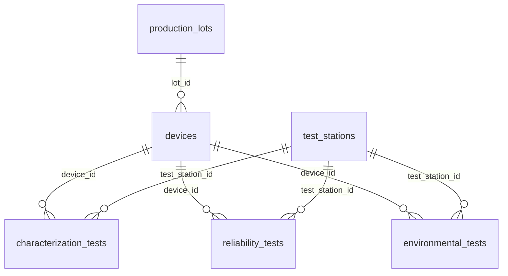

# Data Verification: Supabase Synthetic Dataset

**Status:** in progress, last updated 2026-10-23
**Scope:** what is verified about the existing synthetic dataset, what is assumed, and what is unresolved, before the Next.js dashboard relies on it. This is the only document that states verified numbers. Patterns the generator was *designed* to produce, and earlier unreproduced findings, are in [HYPOTHESES.md](HYPOTHESES.md).

## Ground rules

- **The synthetic data is not modified.** Every check is a read-only query run in the Supabase SQL Editor. The exact queries are in [`db/verification/queries.sql`](../db/verification/queries.sql), referenced here as **Q1–Q18**.
- **Specification limits are not invented.** The database stores `pass_fail` results but not the criteria that produced them. Until the criteria are recovered from the data (Q6) or from the original generator, the application shows only measured outcomes: no spec bands, no Cpk, no "margin to limit".
- **Nothing is assumed silently.** Each fact below is labelled **Verified** (with its evidence), **Pending** (query written, not yet run) or **Open issue** (contradictory or unexplained).

## 1. Schema

Six tables in the `public` schema. Full column listing: [`db/schema.sql`](../db/schema.sql), a hand-maintained snapshot used for documentation and tests. It is not synchronized with Supabase automatically.

| Table | Rows | Grain (one row is…) | Status |
|---|---:|---|---|
| `production_lots` | 20 | one manufacturing lot | Verified |
| `devices` | 10,000 | one sensor device | Verified |
| `test_stations` | 6 | one test station | Verified |
| `characterization_tests` | 40,000 | one device × ion | **Verified** (see 2.3) |
| `reliability_tests` | 160,000 | one device × ion × test day | Unique **verified**, completeness **pending** (Q17) |
| `environmental_tests` | 40,000 | one device × stress profile (expected) | **Pending** (Q18) |

### What the database enforces (Q1)

- Every table has a primary key, and every primary key is a **surrogate text ID** (for example `characterization_test_id`).
- **All seven foreign keys exist and are validated** (none is `NOT VALID`): `devices → production_lots`, and each test table to `devices` and to `test_stations`. Orphan rows therefore cannot exist, so Q9 was retired.

### What it does not enforce

- **No `UNIQUE` constraints on business keys.** The grain above holds in the data (Q7) but is not guaranteed by the database.
- **No `CHECK` constraints.** Category columns (`pass_fail`, `ion_type`, `failure_mode`, `stress_profile`, `shift`, `device_status`) accept any text, and numeric columns accept any value (for example humidity above 100, negative `test_day`).
- **Foreign-key columns are probably unindexed.** Postgres indexes primary keys automatically but not foreign keys. Pending Q2.
- **Timestamps are `timestamp without time zone`.** Acceptable for synthetic data. The application treats them as plain local timestamps and does no time-zone conversion.

## 2. Verified facts

### 2.1 Row counts match the prototype's figures (Q3)

The Streamlit prototype hard-codes "20" lots, "10,000" devices and "240,000+" test records. The live counts are 20, 10,000 and **exactly 240,000** test records (40,000 + 160,000 + 40,000). The dashboard reads counts from the database instead of hard-coding them.

### 2.2 Category values (Q4)

| Column | Values | Notes |
|---|---|---|
| `ion_type` (both test tables) | Calcium, Chloride, Potassium, Sodium | Full names, consistent spelling. 10,000 characterization and 40,000 reliability records each. |
| `pass_fail` (all three test tables) | `Pass`, `Fail` | Exactly two values, consistent capitalization, never null. Safe to filter on `= 'Pass'`. |
| `stress_profile` | Baseline, High Humidity, High Temperature, Thermal Cycling | 10,000 records each. |
| `station_type` | Characterization, Reliability, Environmental | Two stations of each type. |
| `device_status` | `Active` only | **Uninformative**: all 10,000 devices are `Active`, including devices that failed tests. Excluded from quality KPIs until its meaning is validated. |
| `failure_mode` | Calibration Drift, Excessive Noise, Reduced Sensitivity, null | **Open issue**, see section 3. |

### 2.3 Characterization grain: exactly one record per device × ion (Q3, Q4, Q7)

10,000 devices × 4 ions = 40,000 possible pairs. The table has 40,000 rows, no duplicate `(device_id, ion_type)` pairs, and a validated foreign key to `devices`. Therefore **every device has exactly one characterization record for each of the four ions.**

### 2.4 Reliability records are unique (Q7)

There are no duplicate `(device_id, ion_type, test_day)` groups. Each ion has 40,000 records, which is 4 per device × ion on average. **Pending (Q17):** whether there are exactly 4 test days, which would make the device × ion × day grid complete with no missing days.

### 2.5 No retests

Because the characterization and reliability business keys are unique, there are no repeated attempts. **First-pass yield equals final yield**, and no retest rule is needed.

### 2.6 Record-level pass rates (Q4)

| Stage | Passing / all records | Record pass rate |
|---|---:|---:|
| Characterization | 38,707 / 40,000 | 96.77% |
| Reliability | 155,972 / 160,000 | 97.48% |
| Environmental | 38,144 / 40,000 | 95.36% |

## 3. Open issue: `failure_mode` does not align with `pass_fail`

**Evidence (Q4):**

- Reliability records with a non-null `failure_mode`: 4,051 + 4,635 + 3,770 = **12,456**
- Reliability records with `pass_fail = 'Fail'`: **4,028**

So **at least 8,428 records carry a failure mode but passed.** If some failing records have no failure mode, the mismatch is larger.

Also, *Excessive Noise* is the most frequent mode, but `reliability_tests` has no noise measurement to check it against.

**Candidate explanations, not yet distinguished:**

1. `failure_mode` records an *observed degradation mechanism* flagged at a warning threshold below the spec limit. The data would then be meaningful, but the column is misnamed.
2. The synthetic-data generator assigned failure modes independently of `pass_fail`, which would be a defect in the generator.
3. A mix of both.

**How to resolve:** Q14 cross-tabulates `pass_fail` × `failure_mode` with mean drift, error and sensitivity change. If explanation 1 is right, records flagged *Calibration Drift* should show clearly larger drift, and so on for the other modes. The original generator script would settle it directly.

**Impact on the application:** `failure_mode` is **excluded from quality KPIs**, failure counts and any failure-mode Pareto chart until this is resolved. It remains a subject of investigation (Q14, and hypothesis N-01 in [HYPOTHESES.md](HYPOTHESES.md)).

## 4. Unverified assumptions and pending checks

| # | Question | Why it matters | Check |
|---|---|---|---|
| A1 | What criteria produce `pass_fail`? | Needed for `spec_limits`, spec bands and Cpk. **Not invented in the meantime.** | Q6, generator script |
| A2 | Units of `measurement_error`, `drift`, `sensitivity`, `noise` | Axis labels and the analyte metadata | Q5, Q10 |
| A3 | Is `measurement_error` = measured − reference, or a percentage? | Bias analysis | Q10 |
| A4 | Exactly 4 reliability test days, every device tested on each? | Survival-curve denominators (censoring) | Q17 |
| A5 | One environmental record per device × stress profile? | Device-level environmental pass rate | Q18 |
| A6 | Every device has records in every stage? | Rolled throughput yield denominator | Q8 |
| A7 | Do tests use only stations of the matching type? | Station troubleshooting analysis | Q15 |
| A8 | Is calibration age (test date − `calibration_date`) ever negative? | `test_stations` stores a single calibration date and software version, with no history. Negative ages would mean history is missing. | Q12 |
| A9 | Is station assignment confounded with lot or line? | Avoids blaming a station for a line problem | Q13 |
| A10 | Are timestamps in a sensible order (lot → manufacture → tests)? | Data sanity | Q11 |
| A11 | Which indexes exist? | Query performance for drill-downs | Q2 |
| A12 | `environmental_tests` has no `ion_type`. Is `post_test_error` one number per device by design? | Environmental page design | Generator / owner |

## 5. Metric definitions used by the dashboard

Every pass-rate figure in the application states its denominator and is labelled **per record** or **per device**.

| Metric | Definition | Safe to show now? |
|---|---|---|
| Record pass rate (per stage) | passing records ÷ all records in that stage | **Yes**: depends only on verified `pass_fail` values |
| Device pass rate (per stage) | devices whose records in that stage all pass ÷ devices with at least one record in that stage | **Yes**: the denominator is defined by the data, so it stays correct even if coverage differs |
| Device pass rate by ion | devices whose records for ion X all pass ÷ devices tested for X | **Yes** |
| Reliability pass rate by test day | passing records on day *d* ÷ records on day *d* | **Yes** |
| Rolled throughput yield | devices passing every record in all three stages ÷ devices with records in all three stages | **Yes**: defined over devices tested in all stages, and the dashboard shows that denominator |
| Device survival through day *d* | devices with no failure through day *d* ÷ devices still under test at day *d* | Deferred until A4 is verified |
| Cpk, spec bands, margin to limit | n/a | **No**: requires spec limits (A1) |
| Failure-mode breakdown | n/a | **No**: see section 3 |

## 6. Proposed database changes: not applied

None of these has been run. Each needs explicit approval, as reviewed SQL in its own pull request, after the related checks above are complete.

| Change | Purpose | Blocked on |
|---|---|---|
| `analytes` table (ion name, symbol, charge, unit) | Store domain metadata in the database | A2 |
| `spec_limits` table | Store pass/fail criteria explicitly | A1: values must come from evidence, not assumptions |
| `UNIQUE (device_id, ion_type)` on `characterization_tests` | Guarantee the verified grain | Verified; approval only |
| `UNIQUE (device_id, ion_type, test_day)` on `reliability_tests` | Guarantee the verified grain | Verified; approval only |
| Indexes on foreign-key columns | Drill-down performance | A11 |
| Read-only database role for the application | Least-privilege access from Next.js | Approval |
